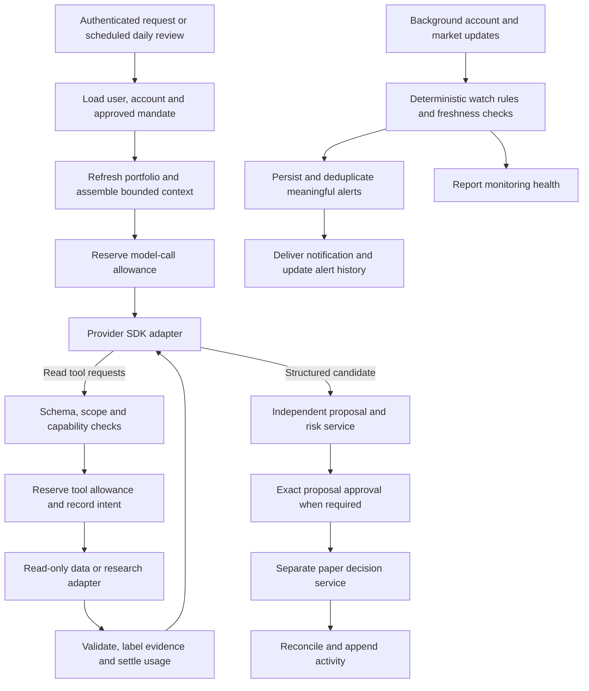

# Pip agent harness: source study and design

Reviewed: 26 October 2026. This is an engineering study and first implementation plan, not a security certification or a comparison of investment performance.

## Product outcomes

The founder defines two primary problems: research takes too much time, and monitoring a portfolio requires constant attention. The harness should deliver concise, sourced research and reliable background observation with meaningful updates. Evaluate time saved, repeated checking avoided, alert usefulness and delivery reliability alongside cost and factual accuracy.

Use separate execution paths for discretionary model research and deterministic portfolio observation. The agreed initial model cadence is one daily review plus research on request. A market update should not automatically become an LLM call. Background watch rules, deduplication, alert persistence/delivery and monitoring health need explicit implementation; none is currently supplied by the tool gateway alone.

## Decision

Build a small Pip-owned application harness with independently enforced policy, an explicit tool registry, persistent run records, and replaceable model adapters. Use established provider SDKs for transport. Keep the durable workflow engine behind an interface until a restart/approval spike demonstrates the right choice.

The current implementation supplies **research boundaries and a local persistent proactive runtime**, documented in [PROACTIVE_AGENT.md](PROACTIVE_AGENT.md). It lives in `packages/harness` and remains separate from the scripted web demo. The official OpenRouter SDK is installed as an opt-in transport; no upstream harness framework has been installed or vendored. Real provider operation and production deployment remain unverified.

## Source review

The links below pin the source revisions read during this study. Additional linked documentation was checked on the review date and can change independently.

| Project and inspected revision | Inspected material | Pattern to bring into Pip |
| --- | --- | --- |
| DeepSeek Harness `22ddee3792402c3e70ec5f86a63c3e3e895a2f60` | [Guarded execution pipeline](https://github.com/deepseek-ai/deepseek-harness/blob/22ddee3792402c3e70ec5f86a63c3e3e895a2f60/docs/tool-execution-pipeline.md); architecture, session, agent-loop and scope package references | Separate the driver, tools, persistence and policy. Record intent before dispatch, guard execution independently, and distinguish transient UI events from committed outcomes. |
| Deep Agents `f26eb54c9b9f66d2ea7edbb9748413d58744534d` | [Architecture](https://github.com/langchain-ai/deepagents/blob/f26eb54c9b9f66d2ea7edbb9748413d58744534d/libs/ARCHITECTURE.md); `graph.py` assembly and summarization middleware | Keep request preparation, context management and tool dispatch separate. Preserve canonical authority outside summaries. Treat compaction as metered work. |
| Pi `d5b3de22d0e24a3e9c38a9410d3329b099717283` | [`agent-loop.ts`](https://github.com/earendil-works/pi/blob/d5b3de22d0e24a3e9c38a9410d3329b099717283/packages/agent/src/agent-loop.ts) and agent-core README | Maintain application messages separately from provider messages; convert at the boundary. Validate tool arguments, respect cancellation and reject calls from truncated responses. |
| LangGraph.js `1d30f8cca03d18b17ea3aabf495e3871f9d3e0bf` | [Runtime README](https://github.com/langchain-ai/langgraphjs/blob/1d30f8cca03d18b17ea3aabf495e3871f9d3e0bf/README.md); official persistence, interrupt and Functional API documentation | Separate durable workflow state from long-term user memory. Model pause/resume explicitly and isolate external effects from replayed computation. |
| Vercel AI SDK `20c4031d1fc59aab54b67c16679e3981374690ab` | [`ToolLoopAgent`](https://github.com/vercel/ai/blob/20c4031d1fc59aab54b67c16679e3981374690ab/packages/ai/src/agent/tool-loop-agent.ts); official WorkflowAgent documentation | Keep provider calls and step controls explicit. An SDK loop and a durable workflow are distinct layers; evaluate both at their actual deployment boundary. |

### Findings that change the design

**DeepSeek Harness.** Its tool pipeline has policy/hooks, monotonic guards, dispatch and outcome processing as distinct stages. Its session reference explicitly says sessions need a persistence backend for durability. Scoped plugin visibility is an organisational mechanism; its scope reference does not present it as a sandbox. Pip will start with reviewed server registrations and fixed guards rather than a general plugin loader. See [session contracts](https://github.com/deepseek-ai/deepseek-harness/blob/22ddee3792402c3e70ec5f86a63c3e3e895a2f60/packages/core/session/README.md) and [scope contracts](https://github.com/deepseek-ai/deepseek-harness/blob/22ddee3792402c3e70ec5f86a63c3e3e895a2f60/packages/core/scope/README.md).

**Deep Agents.** The harness adds middleware and context behaviour over an underlying agent/runtime stack. Its summarization middleware uses an LLM and preserves offloaded history. Pip should keep original evidence retrievable and charge compaction against research budgets; an approved mandate must always be loaded from structured application records. Planning and subagent machinery are optional future needs for this project. See [summarization implementation](https://github.com/langchain-ai/deepagents/blob/f26eb54c9b9f66d2ea7edbb9748413d58744534d/libs/deepagents/deepagents/middleware/summarization.py).

**Pi.** The loop makes request preparation, message conversion, tool invocation and turn completion visible in ordinary TypeScript. It explicitly fails tool calls from token-truncated assistant responses. Pip's first model adapter must surface finish reasons and metered usage separately from model-authored content. A complete JSON object inside a truncated response is insufficient authority to dispatch a tool. The in-process loop alone does not establish crash recovery for our service.

**LangGraph.** Interrupts save state, but resumption can re-run code before the interrupt. The Functional API replays completed task results; an unfinished task may execute again. This is why a database checkpoint does not, by itself, prove an external order happened exactly once. We need operation IDs, recorded outcomes and venue reconciliation before retries. See [interrupt rules](https://docs.langchain.com/oss/javascript/langgraph/interrupts) and [Functional API replay/idempotency](https://docs.langchain.com/oss/javascript/langgraph/functional-api).

**AI SDK.** `ToolLoopAgent` prepares calls and delegates model work to generation/streaming functions. The separately documented `WorkflowAgent` runs inside a workflow runtime with persistent steps and approval suspension. We can use a transport SDK without committing our mandates, ledger or execution authority to its message format. Its workflow runtime still needs deployment-specific evaluation. See [WorkflowAgent documentation](https://ai-sdk.dev/docs/agents/workflow-agent).

## Intended architecture

This diagram is the target flow. Context, registered reads, usage accounting, model-request records and a local proactive loop are implemented. The CLI can use a configured OpenRouter model with public-market tools and a synthetic allocation. Authentication, real account loading, independent proposal/approval integration, real-time watch rules and remote delivery remain open. The scripted web demo is not using this loop.

### Ownership of state

| State | Owner and rules |
| --- | --- |
| User and account identity | Backend authentication and verified account links; never selected by tool arguments. |
| Mandate | Structured, versioned application record, explicitly approved. Summaries and research cannot modify it. |
| Current holdings | Venue reads plus reconciled snapshots and pending-order reservations at the later execution stage. Conversation history is not the source of truth. |
| Conversation and model context | Durable messages, bounded summaries and retrieved records with provenance. A request journal must record the actual model-visible input and tool versions. |
| Workflow progress | Persisted run/step state, separate from chat history. A paused approval is an explicit state. |
| Costs | Tenant-period and per-run ledgers, reservations and actual receipts; internal USD units are separate from the founder's S$200 pilot ceiling. |
| Tool capabilities | Server registry intersected with authenticated permissions, approved mandate, supported product rules and per-run scope. |
| Evidence | Original source records, retrieval time, data mode, identifiers and rights metadata. External content remains untrusted. |
| Execution | Independent paper service now; a separately protected signer/venue boundary only after future approval gates. |

### Proposed run states

`queued -> gathering-context -> reasoning -> reading-tools -> drafting -> risk-checking -> waiting-approval -> paper-recorded -> completed`

Explicit alternate states: `paused`, `budget-blocked`, `cancelled`, `failed`, `reconciliation-required`. These are target states. The local runtime implements `queued`, `running`, `watching`, `needs-input`, `proposal-ready`, `infeasible`, `paused`, `budget-blocked`, `reconciliation-required` and `blocked`; proposal-ready is an unvalidated candidate, not an approval or position.

Each model request will bind the provider/model, run/step IDs, mandate version, snapshot ID, visible tool schemas, prompt version and budget reservation. Persist before dispatch and settle after receiving a trustworthy receipt. Never log raw provider headers, cookies, credentials or hidden reasoning as a requirement for auditing.

### Tool boundary

The conversational policy is retrieval before redundant questions. Inspect connection state first. If authorised sources are available, use them to obtain wallet and venue facts before asking the user. A missing connection should produce a connection action, not an invented snapshot or a request to manually describe retrievable balances. The agent still needs the user's goals, horizon, allocation intent and loss capacity; those cannot be inferred from holdings. Connection discovery and real wallet/venue adapters remain unimplemented.

1. Derive identity and current authority from backend records.
2. Resolve a versioned, server-registered tool that is permitted for this run.
3. Validate strict input arguments. Account routing, credentials and permission metadata travel through the trusted environment, not those arguments.
4. Validate current context and reserve a cost bound atomically against both tenant and run allowances.
5. Commit intent before invoking the adapter, with cancellation and a timeout.
6. Validate the returned shape, size, freshness and usage receipt. Attach provenance outside model-authored data.
7. Commit the settled outcome and replay that outcome on an identical completed-call retry.
8. Keep an uncertain reservation held if dispatch may have happened without a reliable settlement. Do not blindly retry.

Model-facing text is not the enforcement mechanism. Tool adapters are trusted server code; an in-process tool registry cannot sandbox malicious code. MCP must pass through the same gateway, with reviewed server identities and tool definitions. Remote MCP approval settings alone do not establish Pip's authorisation policy.

Before a future batch dispatcher executes any call, validate the complete batch for duplicate IDs, unknown tools and truncated model output. Keep concurrency small and account operations serial until exposure reservations and reconciliation are proven.

### Budget behaviour

- Integer micro-US dollars for compute and tool usage. Reserve a justified upper bound before dispatch, including relevant provider/tool/retry charges.
- Reserve shared tenant-period and run allowances in one database transaction; concurrent tasks must see outstanding reservations.
- Actual model/tool usage comes from trusted adapter metadata, never a field the LLM writes.
- Known charges are recorded even when the returned payload is invalid.
- Timeouts and missing receipts retain reservations. A bound violation records the reported charge and freezes further dispatch for reconciliation.
- A declared bound is only as reliable as provider limits and billing coverage. No hard monetary guarantee is established for an unintegrated provider.
- Discretionary research exhaustion does not disable portfolio visibility, pause/revoke controls or essential monitoring. Budget buckets for essential operations need separate implementation.

### Approvals and execution

The future approval service must bind an authenticated approver to the exact candidate payload, account, mandate version, risk-decision version, snapshot/reservation and expiry. Approval is a structured backend operation. Before applying an approved action, reload current account state and authority; a changed proposal or stale approval requires a new decision.

The harness will return a proposal reference. It will not receive main-wallet keys or general signing access. Trade sizing, market increments, margin/exposure checks and exact signed payload validation remain independent code. No shell, filesystem execution, raw SQL, arbitrary HTTP fetch or live order tool is part of this research foundation.

## Implemented foundation

| Component | What works now | Practical limit |
| --- | --- | --- |
| `contracts.ts` | Strict research context, preserved mandate, freshness checks, character-bound payload, provider-independent adapter contracts | Character length is not a token estimate. No compaction. Caller must load current authority. |
| `tools.ts` | Versioned read registry, typed input/output, complete-batch preflight, per-run scope, trusted environment, cancellation/timeout, bounded output and explicit provenance | No plugin sandbox. Reviewed adapters remain trusted server code. |
| `ledger.ts` | SQLite tenant/run model/tool reservations, bound run scopes, durable intents/results, replay and unknown-outcome holds | No period rollover, operator reconciliation UI or provider-enforced monetary guarantee. |
| `agent.ts` / `agent-store.ts` | Local proactive model/read loop, complete request records, goal checkpoints, leases, next tasks, daily continuation and user follow-ups | Local runtime spike, not production distributed operations; model claims and strategy profitability are unverified. |
| `openrouter.ts` | Official SDK transport with explicit model, bounded output, cancellation, known usage and no automatic retries/fallbacks | Mock-HTTP verification only; no configured key or paid provider call during implementation. |
| `demo.ts` | Offline fabricated portfolio read, database reopen, cached replay, denied order tool | No LLM, wallet, exchange or external network call. |

Existing web sessions and UI remain unchanged. Offline accounting examples use synthetic charges or zero-cost fixtures. A separately invoked real-model CLI requires explicit local configuration and makes paid calls only when run. The package is not exposed by a web route.

## Next implementation gates

1. **Durable run spike.** The explicit local loop, fake adapter, persistence, leases and restart/failure tests are implemented. Compare this approach against LangGraph.js or AI SDK WorkflowAgent on deployment and approval behaviour before selecting a production engine.
2. **Real provider verification.** The opt-in OpenRouter SDK transport is implemented and mock-tested. Select/configure a compatible model and provider-side spending controls, exercise real receipts and quality, and validate billing bounds. No paid calls have been made yet.
3. **Authenticated read-only account context.** Link MetaMask identity and Hyperliquid reads. Add strict account ownership checks, empty-account support, rate limits and freshness/reconciliation tests.
4. **Evidence-backed research.** Add a small approved source set, retrieval provenance and data-rights decisions. Evaluate claims against sources and numerical calculations; test prompt injection and unsupported instruments. A provenance label alone does not prevent hallucinations.
5. **Structured paper proposals and approvals.** Connect to the existing domain checks with exact, expiring approvals and durable transitions. Test stale state, mandate changes, conflicting actions and duplicate retries.
6. **Daily jobs and background monitoring.** Add idempotent daily research triggers, deterministic watch conditions, freshness/worker checks, alert persistence/deduplication and a selected notification-delivery channel. Verify operation while the user's app is closed, useful alerts and delivery timing. Add tenant-period allowances and backups; keep essential monitoring available independently of optional research spend.

Do not add multiple agents or a general plugin marketplace for this slice. Add capabilities only when a specific user workflow and its failure tests require them.

## Verification

Run `npm test`, `npm run typecheck`, `npm run build`, `npm run harness:demo` and `npm run agent:demo` from the root. Tests exercise authority/context checks, isolation, proactive continuation, exclusive workers, crash/reopen replay, batch checks, budget reservations, known/unknown charges, cancellation and the SDK transport against mock HTTP. Completed requests recover without another dispatch; uncertain requests require reconciliation. No test validates investment performance, live trading or real provider billing.
