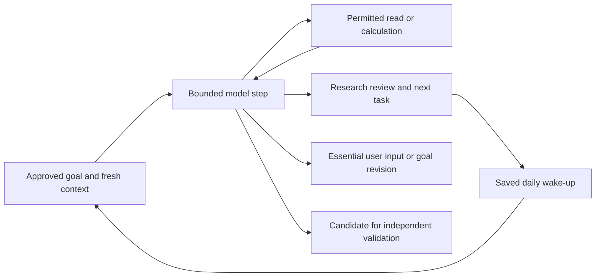

# Persistent research agent

Updated: **27 October 2026**. The reusable runtime lives in `packages/harness`; it is separate from the scripted web app. The former venue-specific live CLI was removed when the founder retired crypto-wallet and Hyperliquid connectivity. Broker/source adapters and their authenticated caller remain to be built.

## Behavior and ownership

The goal is ongoing ownership of the user's mandate: continue the next useful investigation, preserve unfinished work and return with a decision or a concrete next task. A return ambition does not widen approved risk or tool permissions.



An ordinary chat answer does not end a continuing responsibility. A model response must request permitted reads or produce a structured review with a next task. A watching review saves the task and schedules a later cycle; a user-requested review can start earlier. Idle polling does not call the model. A process must invoke the runtime for due work; no hosted scheduler is deployed.

The model selects hypotheses and requests tools within the supplied mandate. Server code owns identity, authority, budgets, timing, replay and dispatch. It checks the approved context before each step. The current context accepts paper-only authority and synthetic/read-only snapshots; production broker/import/freshness contracts still need migration.

## Implemented components

- `agent.ts`: bounded model/read loop, strict reviews, batch preflight, evidence-reference checks, unchanged-read detection, input/output bounds and failure states.
- `agent-store.ts`: SQLite goals, next tasks, checkpoints, model-request inputs, updates, recent user messages and expiring worker leases. Pause fences subsequent dispatch; an already-running paid request may still incur a charge.
- `ledger.ts`: tenant/run reservations, receipts, replay and unknown-outcome holds, with integer micro-US-dollar accounting.
- `openrouter.ts`: reusable official SDK adapter with explicit model, JSON output, no SDK retries/fallbacks, output cap, cancellation and required usage metadata. Verified against mock HTTP only.
- `agent-demo.ts`: deterministic offline continuation, persisted next task, database reopen and simulated daily wake-up.

The generic gateway contains no built-in live market-data or broker tools. A caller must register reviewed adapters and supply trusted account context. The removed research CLI and its configuration are not current setup instructions. `.env.example` is an adapter-configuration reference, not a runnable live service.

## Run the offline examples

```sh
npm run harness:demo
npm run agent:demo
```

Both use fabricated observations; the agent demo also uses fixture model outputs and usage charges. They make no external network or real-model calls and do not start a persistent background service. They verify workflow behavior, not research quality or trading performance.

## Failure and budget behavior

The default proactive cycle has bounded model steps, tool reads, elapsed time, input size and output. Actual limits are set by the caller. Accounting reserves an expected maximum before dispatch and settles from trusted adapter receipts. Missing receipts and interrupted requests retain reservations and block blind retry. A declared reservation is not a provider-enforced billing guarantee.

Completed results replay after restart. Expiring leases allow recovery while fencing stale workers. A cycle can resume against pinned context only while it remains valid; otherwise refresh or reconciliation is needed. Pause, stale authority, malformed/truncated output, invalid evidence, no-progress loops and exhausted budgets produce explicit states.

The current local ledger lacks production period rollover/top-up and operator reconciliation workflows. The S$500 founder operating ceiling is a broader budget, not a limit already enforced across vendors by this runtime.

## Work still required

1. Standard production identity, shared async storage, trusted broker account/context loading and tenant isolation.
2. Tiger contracts/account/price adapters and source-specific freshness/coverage policies; imported data remains explicitly separate.
3. Reviewed macro/source retrieval and deterministic calculation tools, selective skills and versioned research artifacts.
4. Real-provider evaluation with complete usage/cost receipts and selected provider-side controls.
5. Cloud jobs, restart/deploy fencing, next-task/outbox transactions, backups and independent operations monitoring.
6. Deterministic event/position watches, activation acknowledgment, deduplication and remote notifications. A daily review date is not live monitoring.
7. Independent paper proposal/approval integration and later broker order services with their own authority/risk gates.

A `proposal-ready` review is an unvalidated candidate. It creates no approval, position or order. External text and model outputs remain untrusted; shape/citation-reference checks do not prove claim support, suitability or profitability.

## Verification

Current tests cover multi-step continuation, idle/daily behavior, workers, reopen/replay, uncertain calls, authority/pause changes, batch denial, truncation, repeated reads, budget failure, stale context and tenant isolation. Adapter tests use mock HTTP for usage, malformed output, missing receipts and no upstream retry.

See the [baseline report](BASELINE_CHECK.md) for actual check results, [harness design](HARNESS_DESIGN.md) for boundary rationale, and [product plan](PRODUCT_PLAN.md) for the broker-backed implementation sequence. No real provider quality/billing, broker access, hosted observation or notification service has been verified.
