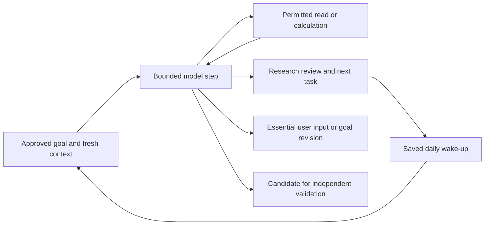

# Persistent research agent

Implemented locally on 26 October 2026. The goal is ongoing ownership of the user's mandate: continue the next useful investigation, preserve unfinished work and return with a decision or a concrete next task. A return ambition does not widen the approved risk or tool permissions.

## Behaviour



The runner does not finish merely because the model has written a chat answer. Its response must request further registered reads or produce a structured review with a nonempty next task. A watching review saves that task and schedules another cycle 24 hours later. A user-requested review can start earlier. Idle worker polling does not call the model.

The model owns hypothesis selection, tool requests and research synthesis within the supplied mandate. Server code owns identity, authority, budgets, wake-up timing, replay and dispatch. It checks the current approved context before each step. “Make me a millionaire” is a target to assess, not authority to add leverage, move funds or promise an outcome. An infeasible review must include a concrete question about revising the target or constraints.

## What works

- `packages/harness/src/agent.ts`: bounded model/read loop, strict review protocol, complete-batch preflight, evidence-reference checks, unchanged-read detection, input/output bounds and structured failure states.
- `agent-store.ts`: SQLite goal state, next task, checkpoints, durable model-request inputs, per-cycle updates, recent user messages and exclusive expiring worker leases. Pausing fences subsequent dispatch; an in-flight provider request may still incur a charge.
- `ledger.ts`: tenant/run model and tool reservations, receipts, cached results and unknown-outcome holds. Existing ledgers gain an operation-kind column; tool event names remain compatible.
- `openrouter.ts`: opt-in official `@openrouter/sdk` 1.5.7 transport. Explicit model, JSON output, no SDK retries or provider fallbacks, token cap, cancellation and required provider cost metadata. Malformed or truncated output cannot dispatch tools; known usage is recorded.
- `scripts/run-agent.mjs`: local worker with two real public-market tools, the existing cross-asset screen and one-market metadata/price/funding refresh. Captured screen inputs are saved under `.data/agent/evidence/` with a hash in the model-visible result.
- `agent-demo.ts`: fully offline deterministic flow that continues from screening to a second investigation, saves the next task, reopens the databases and resumes at a simulated daily wake-up.

The worker is separate from the scripted web app. The CLI's account allocation is explicitly synthetic; its market reads are real and separately labelled. The example goal is a workflow configuration, not evidence of a verified wallet or an approved investment strategy.

## Try the offline flow

```powershell
npm run agent:demo
```

This uses fabricated model outputs, market evidence and usage charges. It sends no network requests and does not start a background service. It shows that the runtime continues work and resumes its saved next task; it does not validate investment performance.

## Configure real model research

1. Copy `.env.example` to `.env.harness`. Set `OPENROUTER_API_KEY` and an explicit `PIP_MODEL` supporting JSON output. Keep the key local; do not paste it into chat. No model is selected automatically.
2. Review `config/research-goal.example.json`. It describes a hypothetical allocation and approved research/paper-only bounds. The CLI rejects a `live-read-only` portfolio input because authenticated real-account loading has not been implemented.
3. Run one cycle:

```powershell
npm run agent:run -- --goal config/research-goal.example.json
```

To leave the local worker checking for its next due cycle:

```powershell
npm run agent:run -- --goal config/research-goal.example.json --watch
```

To request another review with user intent, retaining the approved mandate:

```powershell
npm run agent:run -- --goal config/research-goal.example.json --review "Prioritise testing funding and execution costs."
```

To pause from a second terminal:

```powershell
npm run agent:run -- --goal config/research-goal.example.json --pause
```

The worker uses `.data/agent/work.sqlite` and `.data/agent/usage.sqlite`. Stop with Ctrl+C. Restarting the worker preserves due dates, goal state, request records and usage. The computer and process must remain running for scheduled work; no cloud service or OS startup task has been deployed.

Research messages cannot revise the bound goal, approved mandate or tool grants. Such a revision requires a newly authorised goal/configuration; a production mandate-update flow is still needed. The last five user research messages are supplied as intent data on a fresh cycle, not as permission changes.

## Limits and failure behaviour

Defaults: at most eight model steps, sixteen tool reads and ninety seconds per cycle; thirty seconds per model call; 60,000 input characters and 2,000 output tokens. The public screen adapter has a sixty-second tool timeout and at most sixty public API requests per capture. Cancellation propagates to those requests.

The example allowance is US$1 total for the local tenant and US$0.20 per cycle, with a US$0.05 reservation per model call, all stored as integer micro-US dollars. These are deliberately small development allowances, separate from the overall S$200 pilot ceiling. No funds are spent until credentials/model are configured and the worker is invoked. Existing allowances cannot be enlarged through configuration edits; period rollover, top-ups and operator reconciliation need a separate workflow.

These reservations are accounting controls, not a provider-enforced billing guarantee. Configure provider-side limits before a funded pilot. A cost overrun records the actual charge and freezes further spending. Missing receipts and interrupted requests retain their reservations and block automatic retries. An unresolved zero-cost read is still unresolved; a zero dollar reservation is not proof of completion.

Completed request results replay after a crash without a second dispatch. An expired lease allows recovery by another worker, while a lease token fences old workers. An unfinished cycle can resume against its pinned context while it remains fresh. If its context has expired and every dispatch has a receipt, a new cycle refreshes evidence; otherwise reconciliation is required. The original requests/results remain available in the local journal.

Step/time limits preserve the investigation for the next daily review. Unchanged repeated reads schedule a different investigation rather than busy-looping. Budget exhaustion is visible and does not silently raise the allowance. Protocol failures, changed authority and invalid evidence references block the cycle for inspection. Essential missing user input and goal/constraint conflicts remain explicit questions.

## Practical limits

- This is a local explicit-state runtime spike, not a production distributed scheduler. Database backup, identity, multi-device API access, retention, worker operations and comparison with other workflow engines remain open.
- The installed provider adapter has been tested with mock HTTP responses only. No configured provider key was present during implementation; real model quality, compatibility, latency and billing semantics have not been exercised.
- The two public tools provide market diagnostics and current metadata. They do not establish a profitable entry signal. Longer research histories, economic-source retrieval, deterministic strategy testing and portfolio-wide validation need additional reviewed adapters and evaluation.
- Model outputs and sourced text remain untrusted. Schema and citation-reference checks do not establish that a claim is true, that its sources support it, or that a strategy is suitable.
- A `proposal-ready` review is an unvalidated strategy candidate with risks and outstanding checks. It creates no approval, paper position or live order. Independent proposal/risk checks and exact paper approval integration remain future work.
- Timed reviews are implemented. Deterministic market/portfolio watch rules, event-driven model triggers, monitoring-health checks and remote alert delivery are not. Writing a condition in prose does not activate monitoring. The CLI only prints local updates.
- No wallet connection, signing, fund movement or live trading tools are registered. The web app still uses its separate scripted demo.

## Verification and references

Tests cover multi-step continuation, idle/daily behaviour, exclusive workers, crash/reopen replay, uncertain calls, pause/authority changes, batch denial, token truncation, repeated reads, budget exhaustion/overruns, unsupported instruments, invented evidence, stale context, user follow-ups and tenant isolation. SDK tests exercise the actual installed transport against mock HTTP, including usage conversion, malformed output, truncation, missing receipts and no retry on upstream errors.

Provider references checked during implementation: [official TypeScript SDK](https://github.com/OpenRouterTeam/typescript-sdk), [JSON output support](https://openrouter.ai/docs/guides/features/structured-outputs), and [usage receipts](https://openrouter.ai/docs/cookbook/administration/usage-accounting). Exchange sources and the quantitative screen's limitations are recorded in the [pair study](research/HYPERLIQUID_PAIR_SCREEN_2026-10-26.md).
