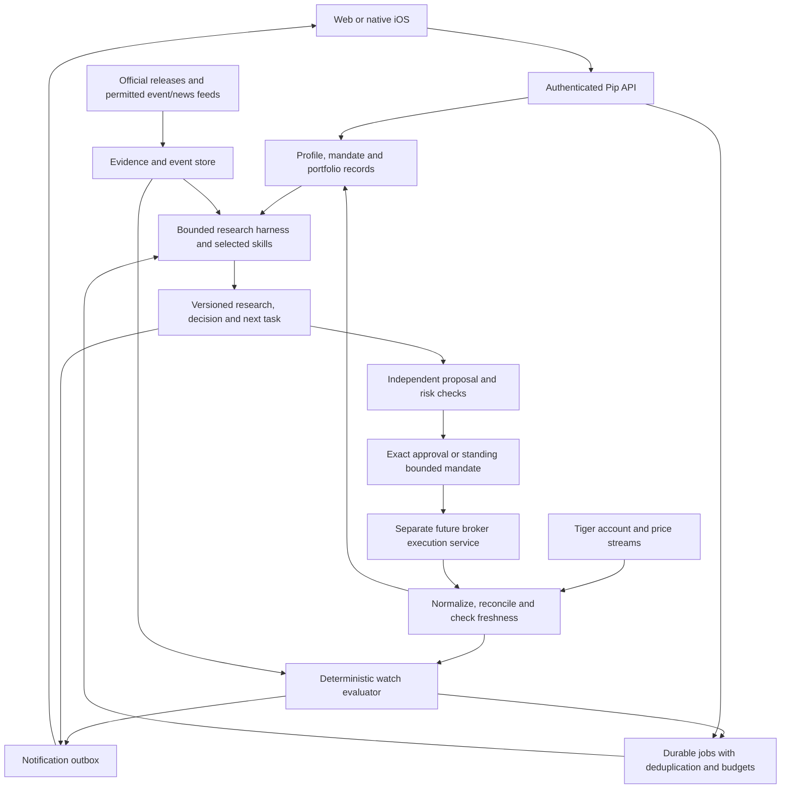

# Pip: multi-user product and delivery plan

Planning baseline: **27 October 2026**. Owner: Alan, solo founder.

**Product direction correction:** build a reusable product for eligible users with different goals, experience, portfolios and holding periods. Alan is the first integration/evaluation account, not the product specification for every user. Multi-user identity, isolated data, individualized mandates and ordinary customer onboarding belong in the initial product foundation. The model gateway will initially reuse OpenRouter; broker access remains a separate authorized connection.

**Current runtime spending instruction:** use provider credits only for connection tests. No generation, paid research, benchmarks or background model activity until a new instruction. OpenAI authentication was verified through the model-list endpoint with zero generation requests; this does not verify inference billing or remaining balance. The existing OpenRouter adapter blocks inference by default. Keys stay in ignored local environment files.

**Broker-only scope confirmed:** funds and trading stay in the user's broker account. The crypto-wallet/Hyperliquid idea is retired, and its connection and execution stack has been removed. A [local Tiger read-only probe](TIGER_ACCESS.md) is implemented and fixture-tested; read-only authorization and bounded live account reads succeeded on 27 October. Futures history and quote permissions remain unresolved; quotes and background monitoring are unverified. An [inline conversational authorization flow](BROKER_ONBOARDING.md) is now implemented with per-session credentials, saved acknowledgments and typed/button account selection; the paper workspace still has no synchronized broker portfolio, and hosted customer access is pending.

This is the current planning entry point. It updates the priorities in the earlier [project handoff](../PROJECT_HANDOFF.md), [harness study](HARNESS_DESIGN.md), and [research skills audit](RESEARCH_SKILLS_AUDIT.md); those files retain useful implementation detail and history. Recommendations here are design decisions to implement and evaluate, not claims that integrations, licences, model quality, or a production service already exist. The ordered work is in [BUILD_BACKLOG.md](BUILD_BACKLOG.md).

## 1. What we are building first

Pip will be a Singapore-first personal investing agent: it knows the user's positions and objectives, keeps researching, monitors meaningful changes, and helps the user make and review decisions. The long-term product supports research/monitoring, approval of each trade, and bounded autonomous trading under separate permissions.

The founder's confirmed starting point is specific:

| Input | Confirmed direction |
| --- | --- |
| Founder | Alan; building alone; five years of professional investment/trading experience |
| First committed user | Alan, even if Pip never becomes a commercial business |
| Existing broker | Tiger Brokers |
| Markets and style | US markets and futures; event/macro driven; holding periods of hours to days |
| Initial operating ceiling | Up to **S$500/month**, excluding existing coding subscriptions and Apple membership |
| Product references | Astor localized for Singapore; proactive, persistent assistance in the spirit of Muse/Dot |
| Clients | Native SwiftUI iOS and web, sharing one backend |
| Commercial ambition | Singapore operation, with the applicable MAS licensing/partner route addressed as the offering develops |

**First deliverable:** a shared web product where each supported user can sign in, describe their needs, establish a profile/mandate, connect an eligible broker or import explicitly labeled holdings, and receive persistent research and monitoring suited to them. The initial released authority is research/monitor only. Trading remains at the broker; order approval and bounded autonomy are later capabilities.

Tiger is the first broker capability to validate, using Alan's account as one test case. Its local CLI is an engineering diagnostic, not the customer product or a shared authorization store. Product development must proceed with multiple isolated test identities and portfolios alongside broker validation. A continuous futures symbol used for charting is not an executable contract.

Initial evaluation must cover at least these user profiles; supported assets and jurisdictions remain explicit rather than promising every broker/market on day one:

| User example | Useful first experience | What must adapt |
| --- | --- | --- |
| Investor with little experience or an unclear goal | Clarify needs, explain a provisional plan, confirm constraints and help understand holdings | Language, question sequence, education and research depth; no inferred trade permission |
| Longer-horizon ETF/equity investor | Portfolio-aware research, concentration/catalyst monitoring and thesis reviews | Holding horizon, review cadence, issuer/company or fund research methods, notification threshold |
| Active macro/event or futures trader | Event scenarios, contract/margin awareness and session reviews | Exact contracts, data freshness, monitoring cadence and instrument-specific risk checks |

These are evaluation profiles, not three mandatory strategy presets. Users should express their own needs; the service derives a supported, explicit scope instead of copying Alan's positions or trading style.

Astor is a useful reference for portfolio-aware briefs, monitoring and conversation. Its current product requires user approval for Text to Trade; its published FAQ says it does not trade autonomously. Pip's proposed autonomous mode is therefore an additional, later ambition. [Astor product and FAQ](https://www.astor.app/).

The first success criterion is usefulness across those supported profiles: less research/monitoring burden, factual and personalized output, durable follow-through and reliable data isolation. Alan's usage supplies early feedback, not proof of broad demand. Investment outcomes should be measured, but a short profitable period does not establish a durable edge or reliable agent.

## 2. What the repository actually gives us

This is a static code audit of the checked-out repository, not a fresh certification of its tests or live integrations.

| Existing part | Reuse | Bridge to the product |
| --- | --- | --- |
| Next.js web workspace and paper domain | Conversation components, explicit paper mandate, deterministic proposal checks, revision handling | Replace the fixed six-question/BTC-ETH demo path with authenticated user context and the research runtime; preserve fixtures as explicitly separate demos |
| `packages/harness` | Typed context/model adapter, reviewed read tools, usage reservations, request journal, replay and uncertain-outcome holds | Add authenticated portfolio context, async production repositories, retrieval, skill routing, production jobs and monitoring |
| Local proactive loop | Goals, next tasks, checkpoints, leases, pause/budget states and daily continuation | Host it reliably; implement actual event/price watches and delivery. The current `watching` state is a future review date, not a streaming market monitor |
| OpenRouter transport | Reuse the existing model gateway and mock verification patterns | Benchmark explicit model/provider routes, measure usage/quality, and enforce production routing/privacy policy; a direct-provider adapter is optional |
| Twelve cleaned research skills | Evidence, company models, valuation, challenge, portfolio decisions, briefs and monitoring methods | Integrate selective loading and artifacts. `skills/catalog.json` currently says `runtimeIntegrated: false`; macro/futures methods need focused additions |
| Broker connection | Local Tiger OAuth/access probe; authorization and bounded live reads verified | Resolve futures history/quote permissions and reconcile actual account/data capabilities, then implement production context, streaming and web/iOS integration |
| Live execution | No live execution package remains | Implement a broker-specific order lifecycle later, with independently enforced risk, exact approvals, durable intents and reconciliation |
| Local SQLite stores | Development fixtures and local examples | Move shared state to Postgres/private object storage before hosting web and workers separately |

Evidence: [research context](../packages/harness/src/contracts.ts), [tool gateway](../packages/harness/src/tools.ts), [agent loop](../packages/harness/src/agent.ts), [agent store](../packages/harness/src/agent-store.ts), [web storage](../apps/web/src/server/store.ts), [demo domain](../packages/domain/src/index.ts), [skill catalog](../skills/catalog.json).

The immediate gap is integration and reliable data, rather than another large prompt collection. The web app and reusable research runtime remain separate. The research context fixes paper-only authority, has no distinct imported observation mode, and applies a uniform freshness gate. Migrate that context to a versioned research/monitor contract with per-source freshness and coverage, without granting execution authority. A local Tiger read-only connection has been verified. Paid-model research, hosted monitoring and native iOS remain unverified. The [baseline report](BASELINE_CHECK.md) distinguishes checks before and after retirement of the old connection stack. CI remains unconfigured.

## 3. Product behavior and authority

| Mode | Pip can do | Activation requirement |
| --- | --- | --- |
| Research and monitor | Read authorized information, maintain theses/event plans, run research, alert, record decisions and suggest responses | Read permissions, selected accounts/positions, an approved monitoring scope and budget |
| Approve each trade | All the above, plus draft an exact order and submit only after its authenticated approval | Supported execution adapter, exact expiring approval, fresh independent checks and applicable broker/regulatory gates |
| Bounded autonomy | Submit eligible actions under an approved standing mandate without confirming every individual order | Separate eligibility/activation, tested execution and reconciliation, explicit risk limits and operating capability |

Autonomy has defined scope: account/sleeve, eligible instruments, capital/risk budget, size/exposure/margin constraints, session/event restrictions, order types and price protections, frequency limits, mandate expiry and revocation. Connecting an account does not authorize Pip to manage its full balance. A conversational change of opinion does not silently change the mandate.

Read/research work already within the user's mandate can continue without repeatedly asking permission. Raising trading authority or changing consequential limits requires the appropriate explicit confirmation. A user can lower authority or pause new activity immediately.

Distinguish **pause new orders**, **cancel outstanding orders**, **stop discretionary research**, and **close positions**. These are different actions with different consequences. Do not silently flatten an account on a feed outage, or remove an existing protective order when a user merely pauses research. Transfers, withdrawals and arbitrary account administration stay outside model tools.

For hours-to-days futures trading, broker-held protective orders and deterministic controls must carry time-critical protection where supported and verified. LLM analysis and phone notifications have variable latency and cannot be the only stop, margin, or liquidation safeguard. A verified receipt means the broker acknowledged an order; it does not guarantee execution at the intended price.

## 4. The daily workflow

Every user shares the same product loop: understand context -> maintain research -> observe relevant changes -> explain decisions -> preserve the next responsibility. The details below illustrate the active-trader branch. Longer-horizon and less-experienced users use their own cadence, sources, language and risk rules; they are not routed into a futures-session workflow by default.

### Before the relevant trading session/event

1. Sync positions, open orders, cash/margin and contract reference data. Mark gaps and stale facts.
2. Reconcile what changed since the previous snapshot, including manual trades made directly in Tiger.
3. Load upcoming macro releases, central-bank events and relevant issuer/commodity events for the selected universe.
4. Retrieve the user's current event thesis and prior decisions. Ask only for missing intent, such as whether an overnight exposure is intentional.
5. Produce a short plan: current exposures, important event times in exchange time and the user's timezone, scenarios, evidence, conditions that would invalidate the view, and the next review.

### During a held position

Deterministic services observe subscribed prices/account changes and evaluate explicit watches. Examples include a price/invalidation level, gross exposure, margin headroom, a contract approaching notice/expiry, a scheduled event window, or a stale feed. They can issue a direct numerical alert without waiting for an LLM.

A material new release or breached thesis condition can enqueue a bounded research task. The agent retrieves the actual release and relevant context, checks the vintage, compares against a timestamped consensus source when available, and explains what changed. It can conclude that there is no justified response and retain a concrete next check.

Do not let every tick/headline trigger a model call. Coalesce related events, attach cooldowns and per-session budgets, and prioritize active holdings over speculative watchlist scans. Research exhaustion must not disable account visibility, revocation, monitoring-health reporting or essential deterministic checks.

### After the position/session

Record the decision, observed fills where available, fees/slippage, thesis evolution and outcome. Distinguish process quality from P&L. Review whether the information was available at decision time and whether the alert was useful. Preserve follow-ups instead of generating the same generic brief every day.

For a Singapore user trading US hours, a useful daily brief may be pre-US-session rather than Singapore morning. Store schedules with IANA timezones and exchange calendars; calculate daylight-saving changes and cross-midnight dates. Do not hardcode a fixed Singapore-to-US offset.

An initial routine can be one daily pre-session review, on-request research, and a capped set of material-event reviews. This is a proposed refinement of the old one-daily-review policy, subject to measured usefulness and spend.

## 5. LLM choice, hosting and evaluation

### Recommended initial model policy

The LLM runs through a **server-side model API**. Pip's backend owns memory, jobs, permissions and budgets; the model is called when needed. A coding subscription or the planner's reasoning setting does not fund a separately deployed product API.

There are two independent connections. **OpenRouter is the initial LLM API gateway**; it supplies access to selected models through one interface. **Broker APIs, approved aggregation services or broker MCP connectors** supply authorized account/order capabilities. A model gateway does not itself grant access to Tiger/Robinhood. MCP standardizes a tool interface but still relies on a real supported connection. Brokerless research can use labeled imports or a watchlist; live account reads/orders require the corresponding authorized integration. [OpenRouter quickstart](https://openrouter.ai/docs/quickstart), [client tool calling](https://openrouter.ai/docs/guides/features/tool-calling).

| Role | Initial recommendation | Reason and limit |
| --- | --- | --- |
| Main conversational/research agent | Existing OpenRouter adapter; evaluate `openai/gpt-6.1-sol` first, then select an explicit passing route/model | Reuse the implemented gateway; benchmark quality, protocol compatibility and cost across user profiles before setting a product default |
| Cheap extraction/triage | Evaluate `gpt-6-luna` after the main path works | Use only where source extraction/classification is measurable; it cannot independently authorize a trade or certify a risk calculation |
| Independent research challenge | First use a separate structured challenge pass with fresh evidence; benchmark `claude-sonnet-5-5` selectively | A second model can reveal different errors, but agreement is not proof and routine double-processing adds cost |
| Alternative cost/quality candidate | Benchmark paid `gemini-3.8-flash` on the same cases | Useful alternative; do not assume cheaper tokens imply lower cost per successful task |
| Financial arithmetic and controls | Deterministic code | Position sizing, ticks, P&L, margin checks, permissions and order validation cannot depend on prose arithmetic |

Official documentation currently lists Sol at **US$2 input / US$10 output per million tokens**, with short-context cache reads at US$0.10 and separate write pricing. Its documented API reasoning efforts are `low`, `medium`, `high`, `xhigh`, `max`; the direct OpenAI endpoint uses Responses for tool calling. This direct-provider reference does not describe the existing OpenRouter JSON protocol. Keep standard service initially, and avoid maximum effort and very large contexts by default. [Sol documentation](https://developers.openai.com/api/docs/models/gpt-6.1-sol).

Luna currently lists **US$0.10 input / US$0.50 output per million tokens**. It is a candidate for focused tasks, not a substitute for testing. [Luna documentation](https://developers.openai.com/api/docs/models/gpt-6-luna). Sonnet 5.5 currently lists **US$2 / US$10**. [Sonnet documentation](https://platform.claude.com/docs/en/models/sonnet-5-5/overview). Gemini's current Flash pricing includes promotional periods, so confirm the paid tier/rate at the time of the benchmark rather than building a business on the introductory price. [Gemini pricing](https://ai.google.dev/gemini-api/docs/pricing).

Use the existing OpenRouter adapter as the primary initial transport. It already uses an explicit model, bounded JSON protocol, usage receipts, no automatic retries/fallbacks and a data-collection restriction. It is mock-tested, not live-provider verified. The current adapter passes Pip's reviewed-tool descriptions in its JSON protocol; native function calling/MCP is a separate integration, not a capability already activated by selecting OpenRouter.

The public OpenRouter catalog checked on 27 October lists `openai/gpt-6.1-sol`, `anthropic/claude-sonnet-5.5` and `google/gemini-3.8-flash`. Catalog availability is not an account-level quality/billing verification. Model/provider routing, required parameters and retention constraints must be explicit. Existing data-collection filtering is not proof that every retention/region requirement is met. No silent fallback to an unassessed processor. A direct-provider adapter can be added later for a demonstrated capability, contract, residency or cost need. [OpenRouter model catalog](https://openrouter.ai/api/v1/models), [provider routing](https://openrouter.ai/docs/guides/routing/provider-selection).

Pip customers should not need model-provider API keys. The backend owns provider configuration and product billing, with separate user/run usage ledgers. A future bring-your-own-key option is not a prerequisite for normal onboarding. Provider outage behavior remains explicit: observation/controls continue where available, research is visibly delayed, and permissions never expand.

No self-hosted GPU or fine-tuning is needed for the initial product. Fresh facts come from tools; user memory comes from retrieval. Fine-tuning can be reconsidered after we have a stable, consented evaluation/training dataset and a specific recurring error it can address.

### Evaluation before committing to a model

Use Alan's professional experience to create 30–50 initial cases with expected facts, acceptable conclusions, forbidden actions and source vintages. Include:

- Multiple isolated user profiles: unclear novice goals, longer-horizon ETF/equity portfolios, research-only users without accounts, and active event/futures trading.
- Different users asking the same question with different holdings, restrictions and horizons; responses must use their own current facts without cross-user leakage.
- A macro actual versus consensus/prior revision, with conflicting early headlines.
- A futures month/multiplier mismatch, a continuous symbol, expiry/notice, and changing margin requirements.
- Long/short exposures and open orders creating more aggregate risk than individual positions suggest.
- A stale account/feed, partial broker response, missing consensus and an unsupported instrument.
- A position's original thesis becoming invalid despite positive P&L, and a sensible no-action result.
- A malicious retrieved document, a fabricated citation, and an attempted authority change through chat.
- A US daylight-saving/date rollover and a rescheduled release.
- A paid call with an unknown outcome and a research artifact invalidated by new evidence.

Compare source-supported material claims, numerical correctness, vintage handling, missed material events, actionable next tasks, latency and **cost per accepted result**. Use held-out cases and manual founder grading; do not grade only style or let a model grade itself without checks. Capture full billable usage, including reasoning/tool loops and repair attempts.

Initial targets: all deterministic authority/isolation/replay tests pass; no fabricated material source or critical contract-unit error in the release evaluation; at least 90% of cases judged useful by Alan. These are proposed release criteria, not established performance. Any critical failure blocks that capability even when the average score is high.

## 6. Harness and deployment

Keep the Pip-owned TypeScript harness and its domain boundaries. Use official provider SDKs for transport. Add a small, durable job layer around it; avoid replacing the existing policy/ledger with a coding agent that has unrestricted shell/browser access.

**Recommended initial hosted stack:** existing Next.js/TypeScript web/API, one Node research/monitoring worker, Supabase Auth/Postgres/private Storage in exact Singapore `ap-southeast-1`, and an optional small Python Tiger adapter if the chosen authorization path needs it. Render Singapore is a practical web/worker host candidate. Confirm memory, stream reconnect behavior and the adapter in a deployment spike before buying capacity. [Supabase regions](https://supabase.com/docs/guides/platform/regions), [Render regions](https://render.com/docs/regions).

This is a modular application, not a fleet of autonomous specialist services. Keep domain modules for portfolios, evidence, research, watches, notifications and execution. Split processes only where runtime/lifetime or credential isolation requires it.

The first shared backend must have production-style user identity, server-derived tenant/account scope, per-user profiles and mandate versions, isolated conversations/research/retrieval, per-user budgets/jobs, and separately owned broker connections. Prove these boundaries with at least two test identities before calling the workflow product-ready. The standalone Tiger probe's machine-local OAuth home is not a multi-user credential store and must not be reused as one. External personalized pilot access still follows the applicable eligibility/regulatory gates.

Use Postgres jobs/row leases plus a transactional outbox, or evaluate the managed Postgres queue already available in Supabase before writing queue mechanics. Claim work in short transactions, use database time and fencing, and never hold a DB transaction open while waiting for a model. Queue delivery is not exactly-once execution of outside effects. [Supabase Queues](https://supabase.com/docs/guides/queues), [PostgreSQL locking](https://www.postgresql.org/docs/current/sql-select.html).

A research run must end as completed, scheduled with a next task, waiting for named input, deliberately paused, or blocked with a recovery action. Store the next task and notification intent with the completed artifact transaction. An ordinary answer or restart must not erase a continuing responsibility; an uneventful session also does not require pointless new analysis.

Keep model/provider transport and durable orchestration separate. OpenAI's SDK/hosted agents and LangGraph are credible alternatives, but none supplies Pip's portfolio truth, mandate semantics or broker reconciliation automatically. Reconsider orchestration tooling when branching, long approval waits, workflow migrations or operational debugging cost more than adoption saves. Do not build a general workflow platform first. [OpenAI agent options](https://developers.openai.com/api/docs/guides/agents), [LangGraph persistence](https://docs.langchain.com/oss/javascript/langgraph/persistence).

Deployment details that must be tested:

- Replace synchronous SQLite stores with async repository operations and atomic transactions; do not scatter network SQL calls through the existing loop.
- Bind hosted Next.js to `0.0.0.0:$PORT`; its current local loopback setting is for development. [Render web services](https://render.com/docs/web-services).
- Render filesystem state is ephemeral by default. Store research/evidence in Postgres/object storage, not worker files. [Render disks](https://render.com/docs/disks).
- Deploys can overlap workers. Database claims and fencing remain necessary with a nominal single worker. Drain on shutdown, and test abrupt death. [Render deploy lifecycle](https://render.com/docs/deploys).
- Choose an appropriate Supabase connection mode: direct/session pool for persistent workers; verify IPv4/IPv6. Avoid relying on session locks with transaction pooling. [Database connections](https://supabase.com/docs/guides/database/connecting-to-postgres).
- Use an independent heartbeat/watchdog; a dead monitoring worker cannot report its own death. Track stream gaps, reconnects, last successful account reads, queue lag and delivery outcomes.

## 7. What data the agent needs

Create broker-neutral typed records before expanding the model's prompt. The current context's cash and symbol/notional fields are insufficient for actual short-term futures monitoring.

| Data group | Minimum useful fields | Truth owner and important limit |
| --- | --- | --- |
| Account snapshot | Broker/account identity, equity, cash by currency, settled/available funds, buying power, margin requirements/headroom, source/receipt time, coverage | Broker adapter; missing and zero are distinct |
| Position | Exact instrument/contract, side, quantity, cost basis if available, mark/bid/ask timestamps, multiplier, currency, unrealized P&L, assigned sleeve | Broker holdings plus verified contract master; reconcile manual trading |
| Orders and fills | Venue IDs, client operation ID where supported, status, remaining quantity, order type, prices, linkage/protective orders, fills/fees/time | Broker is the source of execution truth; include pending risk |
| Futures mechanics | Exchange, underlying, contract month, tick size/value, multiplier, session/maintenance breaks, settlement method, expiry, first notice where applicable, limits and margin vintage | Contract/venue reference data; continuous series never routes directly to execution |
| Prices and FX | Bid/ask/last, timestamp/sequence, delayed versus real-time status, session, permitted use and entitlement | Entitled broker/vendor data; derived values retain their input snapshot |
| Macro calendar | Event ID, series/units, reference period, publication time/timezone, update status, source and next release | Official calendar/feed; schedules can change |
| Macro release/expectations | Actual, prior as then known, revised prior, consensus source/vintage/dispersion when available, revision history | Store observations separately; official data does not automatically provide analyst consensus |
| Market context | Relevant rates/curve, FX, volatility, related futures, liquidity/spread and event reaction windows | Add only factors relevant to supported trades; licensed point-in-time data needed for serious testing |
| Thesis/event plan | User hypothesis, catalyst, holding window, scenarios, invalidation conditions, expected reaction and alternative explanations | Distinguish user belief, model inference and externally verified fact |
| Mandate | Included accounts/sleeves, intended capital, exclusions, loss/exposure/margin limits, authority, version and expiry | Structured user-approved record; holdings never establish consent |
| Research and learning | Sources, assumptions, forecasts, challenge, decision/action and subsequent outcome | Versioned artifacts and decision journal, with evidence available at that time |
| Operational state | Last successful sync, entitlement failures, missing instruments, stream lag, active watches, schedule/notification health | Backend monitoring; absence of alerts is not evidence of healthy monitoring |

Use decimals/fixed-point values with explicit units/currencies, not arbitrary floating-point calculations for money/ticks. Equity exposure, futures notional, margin used and loss under a scenario are different quantities. For a futures move, derive P&L from direction × contracts × multiplier × price change, then reconcile with broker accounting and fees. Daily settlement can change reported cost/P&L semantics.

Never invent buying power or margin from a generic formula when the broker's rules/account mode are unknown. Correlation and separate tickers do not establish diversification. Options, futures options and other derivatives remain explicitly unsupported until their own mechanics/risk coverage are implemented.

### Data acquisition sequence and rights

Start with the founder's legitimately entitled Tiger data, official releases and a small approved source set. Tiger documents separate API market-data entitlements from its app subscriptions. Its futures endpoints expose contract metadata and quotes/bars, but this does not prove access for Alan's account or chosen contracts. [Tiger overview](https://docs-en.itigerup.com/docs/intro), [futures data](https://docs-en.itigerup.com/docs/quote-future).

Use the [BLS calendar feed/instructions](https://www.bls.gov/help/hlpiCAL.htm), [Federal Reserve calendar/releases](https://www.federalreserve.gov/monetarypolicy/fomccalendars.htm), [BEA schedule](https://www.bea.gov/news/schedule/), [EIA release schedule](https://www.eia.gov/reports/upcoming.php) and relevant Treasury releases according to actual instrument exposure. Their websites establish source facts/calendars, not a low-latency tradable-news SLA. Acquire timestamped consensus and fast news separately if needed. US company research can use [SEC APIs](https://www.sec.gov/search-filings/edgar-application-programming-interfaces) and issuer releases under applicable access terms.

Maintain a rights matrix per provider: personal/internal use, professional classification, automated/non-display/AI use, storage, derived analytics, external display, redistribution in alerts, attribution, deletion and per-user fees. Five years of professional experience does not tell us the founder's current data-entitlement classification. A retail quote subscription does not establish rights for a multi-user AI service. CME's policies explicitly distinguish display and non-display uses. [CME licensing guidance](https://www.cmegroup.com/market-data/distributor/files/cme-group-data-licensing-policy-guidelines-and-non-display-licensing-faq-october-2024.pdf).

CME also publishes specific guidance on AI/LLM access, entitlement controls and derived outputs; real-time and delayed feeds both require checking the applicable permitted use. Confirm the actual Tiger/distributor agreement rather than assuming either that retail display rights cover an external LLM or that all contracted feeds prohibit AI. Until verified, keep affected quote data out of external model context; official-document research can progress separately. [CME AI advisory](https://www.cmegroup.com/files/download/ai-data-services-advisory.pdf).

Buy the narrow data depth the first workflow needs. Do not promise broad live futures, full-depth books, premium breaking news or redistribution within S$500 until specific quotes and terms are verified. If the necessary data exceeds the ceiling, reduce supported coverage or seek a deliberate budget change; delayed data must remain visibly delayed.

## 8. Research tools, skills and quality

### Shared research and private interpretation

User-approved direction: build a reusable common research layer, then personalize its implications. This is planned architecture; no live research pipeline or paid inference has been enabled.

For example, ingest a CPI release once, preserve the exact actual/prior/revision/consensus vintages, verify the common facts and produce a source-backed market interpretation. Eligible users can reuse that artifact. Their positions, risk exposure, thesis changes, mandates and suggested responses are evaluated separately. The common layer must never contain personal holdings, chats, uploaded private research or conclusions derived from a user's private context.

Deduplicate concurrent work by source/event identity and vintage, instrument/dated contract where relevant, content version, research method/model version and applicable rights/entitlement group. Use one bounded job for common work rather than one independently billed investigation per subscriber. Keep provenance, quality status, source time and invalidation dependencies; corrected releases, new evidence and expired rights invalidate affected artifacts. A cached artifact must not imply a fresh broker observation.

Sharing is permitted only where source licences and each recipient's access allow it. Private material stays in tenant-scoped retrieval/storage; broad caching does not grant rights to premium data. Common costs are metered once to the platform/shared budget, with an explicit allocation for unit economics; each user's interpretation consumes their own allowance. Verify two users can reuse allowed common facts while neither can retrieve the other's private facts, and that concurrent requests cause only one shared dispatch.

### How an agent actually researches

The model should be able to plan and use a reviewed tool set within its scope, rather than answer only from pretrained knowledge. Initial tool capabilities should include:

1. Read the current portfolio, orders, instrument metadata, entitlements and monitoring health.
2. Search permitted public sources and fetch approved documents with timestamps and provenance.
3. Retrieve macro releases/calendars, relevant company facts and timestamped licensed market/consensus observations.
4. Read existing research, thesis assumptions, event plans and prior decisions.
5. Run deterministic calculations, scenarios and later restricted historical studies.
6. Save versioned artifacts and request a watch; activation requires an acknowledged watch-service record.
7. Draft a candidate decision and schedule the next task. Notification and trading routes remain separately governed.

No live market-data/retrieval CLI remains after the old venue-specific tools were removed; these capabilities must be implemented for the broker-backed workflow. Search can start with provider web search, whose current listed tool fee is US$10/1,000 calls plus model-priced search content. OpenAI supports domain filters and returned source references, which can help a primary-source workflow. Searches alone do not establish the truth of a claim. [Search pricing](https://developers.openai.com/api/docs/pricing), [web search controls](https://developers.openai.com/api/docs/guides/tools-web-search).

Fetch outside text through a service with response-size/time limits, MIME checks, safe redirects and network-address restrictions. Treat web pages, uploads and MCP results as untrusted evidence, never permission or system instructions. Keep broker credentials and user identifiers out of search queries. Reviewed MCP can be an adapter behind Pip's gateway; installing a server does not grant every exposed tool to the model.

For data analysis, prefer reviewed deterministic functions first. Add Python only in a constrained calculation environment with explicit inputs/outputs and resource/network limits. A generated script must not inherit broker credentials or open-ended network access. Walk-forward/backtesting needs costs, spread/slippage, contract rolls, point-in-time data and out-of-sample evaluation; a good-looking backtest or narrative is not a validated edge.

### Are the current skills enough?

They are a strong analytical starting point, **but they are not yet enough for the founder's macro/futures workflow**. The company-model sequence is valuable when issuer fundamentals matter. Futures/event research should take the non-company route, without forcing every task through a three-statement model and DCF.

| Method | Current state | Work needed |
| --- | --- | --- |
| Evidence intake, challenge, portfolio fit, concise briefs, monitoring/review | Authored methods and handoff validators | Load them selectively, connect tools/artifacts, and evaluate actual behavior |
| Company research | Detailed model-first route | Retain as a conditional branch for equities/earnings and look-through work |
| Macro/event research | Broad cross-asset scaffold | Add release/consensus vintages, revisions, scenario trees, expectations versus outcomes, event windows and calendar changes |
| Futures mechanics | Some general strategy/risk guidance | Add exact contract identity, multiplier/ticks, margin, session/expiry/notice/roll, liquidity and execution-cost analysis |
| Position/event triage | General monitor specification | Add relevance ranking, state changes, urgency, cooldowns, missing-data behavior and pre/post-event follow-through |
| Onboarding and mandate | Demo questionnaire | Add progressive profile/intent capture, separate authority and scope, and memory correction |

Proposed additions are focused methods, not implemented skills: `pip-macro-event`, `pip-futures-position`, and a position-triage extension to `pip-monitor-review`. Add profile/mandate guidance when implementing onboarding. Every addition must specify inputs, tool requirements, output schema, evidence rules, failure behavior and evaluation cases.

Integrate a versioned skill catalog into the runtime with task routing and progressive loading. Keep the coordinator plus only the relevant specialist/references in context. Persist the chosen skill/prompt versions, source IDs and dependency graph. A revised release or changed mandate invalidates affected downstream artifacts. Skills neither supply source access nor enforce permissions by themselves.

## 9. Memory and personalized research storage

Use **Postgres as the structured system of record** and **private object storage for source files/artifacts permitted to be retained**. Start with metadata/full-text retrieval; add a vector index only when it measurably improves retrieval. Embeddings are an index, not the authoritative memory or portfolio.

| Store | Example records | Rules |
| --- | --- | --- |
| Identity and profile | User, residency/eligibility state, preferences, timezone | Minimize sensitive fields; allow correction; separate from model-visible context |
| Authority | Versioned mandate, scopes, consents, revocations | Explicit and auditable; no changes by summary or inference |
| Accounts | Connections, normalized snapshots, positions, orders, fills, reconciliations | Every read identifies tenant/account, source, freshness and coverage |
| Conversations | Messages, attachments, bounded summaries | Shared web/iOS state; preserve links to original evidence and structured decisions |
| Evidence | Source URL/document ID, publisher, published/retrieved time, vintage, hash, units/period, rights | Retain permitted originals/excerpts; corrections do not silently overwrite history |
| Research | Thesis versions, event plans, calculations, challenge, conclusions and next tasks | Dependency-aware; distinguish fact, assumption, forecast, user belief and derivation |
| Operations | Runs, steps, leases, watches, notifications, usage/reservations, model/skill versions | Replay settled effects; park uncertainty; show health and continuation |
| Decisions/execution | Candidates, checks, approvals, intents, venue receipts, outcome reviews | Immutable approved payload reference; order truth reconciled with broker |

Load the minimum useful context per model run: current mandate, reconciled portfolio summary, relevant open orders/contracts, event/thesis state, selected fresh evidence, recent decisions and unresolved tasks. Never resend the entire history on every call. Canonical limits and current holdings always come from structured records.

Tenant/account isolation must apply to SQL, object access, retrieval and any shared cache. Supabase RLS is helpful but privileged backend access still needs explicit tenant checks. Separate shared issuer/macro facts from private portfolio conclusions, and share facts across users only where rights permit. [RLS behavior](https://supabase.com/docs/guides/database/postgres/row-level-security).

Include backups, a tested restore, export/deletion, retention rules, access logs and migration rollback in the pilot. Keep secrets in a server-side secrets store, never research text or model context. Avoid capturing raw credentials or hidden chain-of-thought as an audit requirement; store visible inputs, tool facts, outputs, concise rationale, versions and receipts.

Singapore database placement does not mean all processing stays in Singapore. OpenAI documents endpoint/model-specific retention and residency conditions: `store:false` is not a general zero-retention guarantee, default abuse logs can be retained, and Singapore storage availability does not imply Singapore inference. Confirm account eligibility and subprocessors; do not promise local-only processing. [OpenAI data controls](https://developers.openai.com/api/docs/guides/your-data). Singapore's transfer-limitation requirements need a data-flow assessment rather than a hosting label. [PDPA section 26](https://sso.agc.gov.sg/Act/PDPA2012?ProvIds=P16-).

## 10. Tiger first, other brokers later

Start Tiger feasibility in **week 1**, in parallel with shared identity, broker-neutral contracts and product onboarding/research. Alan's existing account is an access-validation case. Remaining broker gaps must not block the reusable product: use tenant-isolated fixtures and explicitly labeled imports while resolving access.

Current Tiger docs support scoped individual OAuth with selected accounts and separate query/trading permissions; current OAuth SDK coverage is Python/Java. Authorization can expire, so renewal and stale/disconnected monitoring are part of the product. Signature access has broader permission implications. Prefer a scoped read-only route and, if required, a small private Python adapter behind the TypeScript interface. [Tiger authentication](https://docs-en.itigerup.com/docs/authentication).

Its account API can query futures positions and exposes a separate futures asset segment (`C`). The documented consolidated flag aggregates securities/funds, so it must not silently replace the futures segment. Its estimated-tradable-quantity helper does not support futures. Use verified futures-segment data and independent tested controls rather than a stock sizing helper. [Tiger account queries](https://docs-en.itigerup.com/docs/accounts). Contract metadata also includes account-relevant margin/tradability fields whose actual coverage must be checked. [Tiger contract information](https://docs-en.itigerup.com/docs/get-contract).

The feasibility spike must demonstrate, without submitting orders:

- Actual Singapore account/API activation and the precise account types to read.
- The founder's traded futures contracts: reference metadata, live quote entitlement, positions, margin, open orders and fills.
- Streaming account/price changes, reconnect/reconciliation, sequence gaps, rate limits and app/API entitlement interaction.
- Authorization expiry/renewal, revocation, empty/partial results, and missing/unsupported contracts.
- Current subscription cost, professional/non-professional status and permitted AI/internal use.
- The exact supported paper/sandbox instruments and order types for later work. Do not assume every advertised futures product can be paper traded through this account/API.

There is an explicit documentation conflict: Tiger's introductory coverage and its dedicated account-types page differ on futures paper support; the latter marks it unsupported. Resolve this through the actual account/provider before promising broker sandbox tests. Meanwhile build a **Pip shadow/replay simulator** with disclosed spread, fill, fee, slippage and latency assumptions. It supplies simulation evidence, not proof of broker execution. [Tiger account types](https://docs-en.itigerup.com/docs/account-type).

The first hosted monitoring milestone requires live supported reads. CSV/statement import is a useful development and research fallback, but cannot honestly provide unattended intraday awareness of later trades or margin changes. Label import timestamps and disable unsupported live-monitoring claims.

Commercial multi-user access is a separate dependency. Tiger has a Singapore enterprise API with third-party account binding, but admission, agreement, pricing and regulatory conditions remain unverified. Prepare a concrete product/data-flow brief and pursue that route before promising public broker connectivity. [Tiger enterprise overview](https://enterprise-docs.itigerup.com/reference/overview).

Investigate that customer-access route now, not only after finishing a personal tool. The target UI is ordinary application sign-in followed by a supported broker authorization flow, with per-user connections, scope disclosure, renewal and revocation. Do not assume every customer must become an API developer or upload private keys; equally, do not promise no activation requirements until the relevant partner/retail route is verified. An aggregation provider can be evaluated if it supports the required Singapore account types, freshness and rights. Account aggregation and trading authorization may use different providers/flows.

Moomoo is a later candidate: its newer docs describe REST/WebSocket access and OAuth2.1 for third-party apps, beyond the older OpenD route, but Singapore account/commercial eligibility needs checking. [Moomoo getting started](https://open.moomoo.com/api/overview/getting-started). Robinhood now has official external-agent support, yet the relevant Singapore availability is not established; it should not drive the local first release. [Robinhood agent access](https://robinhood.com/us/en/support/articles/onboarding-an-external-agent/). Keep the adapter interface open without implementing several brokers at once.

## 11. New-user onboarding

Build a short, progressive conversation supported by structured records. Broker setup belongs in that conversation: broker selection, read-scope explanation, inline authorization action, typed/button account choice, saved confirmation and recovery. Keep only broker-controlled login/consent outside Pip, then resume the same thread automatically. The local prototype now supports narrow setup shortcuts without model calls; hosted identity/callbacks and general agent conversation remain future work. Do not ask users to recite holdings the authorized broker can supply, and do not force a long questionnaire before showing useful output.

1. **Identity and eligibility:** sign in with a standard account identity; establish jurisdiction, supported offering, timezone and base currency. Link broker access separately from application identity.
2. **Choose the starting job:** position/event monitoring, research, or both. Explain the capability actually available in the current release.
3. **Connect read-only or import:** show permissions and unsupported coverage. Keep an unconnected preview explicitly provisional.
4. **Reconcile:** show accounts, positions, contract months, cash/margin, outstanding orders, freshness and missing data. Let the user correct an import without overwriting verified broker facts.
5. **Understand intent:** goals, horizon, liquidity needs, loss capacity/tolerance, experience, restrictions, existing positions to include/exclude, and intended capital. For a short-term trader add event/overnight/weekend tolerance and preferred holding windows. Holdings cannot answer these questions reliably.
6. **Capture the current thesis:** ask why key positions are held, relevant catalysts and invalidation conditions. Label user opinions as such. Start with a few important positions; collect more progressively.
7. **Confirm the scope:** present an editable structured research/monitor mandate, limits, budget, included holdings and excluded actions. Default to research/monitor only.
8. **Deliver first value:** a sourced, portfolio-specific event/session brief and a small number of proposed watches. Target under ten minutes for a supported simple account as a hypothesis to test.
9. **Activate monitoring:** the service acknowledges active watches, coverage and cadence; choose notification channel, urgency/quiet hours and how monitoring failures are reported. User sees active versus planned watches and last successful sync.
10. **Expand authority separately:** after later eligibility checks, explain and confirm exact-trade approval or bounded autonomy in their own flows. Always retain account/mandate/decision history across mode changes.

This core onboarding belongs in the initial shared web slice. It is not deferred until Alan's personal workflow is finished. Begin with isolated synthetic users and labeled imports; permit real external use only within the assessed product scope. A missing broker must not block goal discovery and useful clearly provisional research.

For an approved trade, show exact account, executable contract, side, quantity, order type, limits/price protection, time-in-force, expiry, material risk/margin effects and fees assumptions. Bind approval to a payload hash/version, current mandate and snapshot, approver and expiry. Recheck before dispatch; changed proposals or materially changed state require a new decision.

The interface should expose conversation, a current portfolio/health view, event plans/research, and decision/activity history. Avoid a full professional terminal in the first release. The backend—not an open app—performs monitoring.

## 12. iOS timing

Start the native SwiftUI shell once the first authenticated research/portfolio API and daily workflow work, approximately **weeks 8–12** for the useful initial client in this plan. A lightweight prototype can validate phone reading and alert actions earlier, and native work can overlap the ten-session monitoring trial once the backend is stable. Do not build a separate mobile agent/state stack.

First native scope: sign in, shared conversation, portfolio/contract freshness, event brief, research detail, notification deep links, monitoring-health state, and pause/revoke controls. Initially retain web for setup, imports and detailed analysis. Add exact paper/trade approval only when its backend exists. Verify expired sessions, interrupted network, duplicate taps, stale research and revocation on a physical iPhone.

Push is useful for this product, but delivery timing is not a trading guarantee. Begin founder monitoring with one simple channel, then add APNs and visible alert history. The iOS app does not need to remain running for backend observation. Avoid voice, widgets and Watch integration until the core workflow is used daily.

## 13. Cost and revenue model

### Founder operating budget

Use **S$500 as a ceiling, not a target to spend**. The following is a planning allocation, not vendor quotations or a commercial launch budget.

| Monthly bucket | Allocation | What to verify |
| --- | ---: | --- |
| Hosting, auth, database, storage and worker | S$80 | Node/adapter memory and database needs; add-ons/backups/egress |
| LLM inference and search | S$150 | Actual reasoning/output, tool loops, reviews, retries and per-run caps |
| Tiger API/exchange data, event/consensus/news | S$170 | Actual futures subscriptions, permitted use, professional classification and coverage; reduce scope if insufficient |
| Notifications, watchdog and operational tools | S$30 | Delivery channel, independent health checks and logs |
| Contingency | S$70 | Usage spikes, necessary data or capacity changes |
| **Total ceiling** | **S$500** | Excludes founder pay, legal/licensing/capital, insurance, commercial broker/data agreements and acquisition |

Any non-display/AI/data fees required for the founder's actual use count inside this ceiling. Excluding a later commercial agreement does not waive a fee needed by the personal prototype. Reserve the necessary data spend first, then fit infrastructure/model activity within the remainder.

For scale context, Supabase Pro starts at US$25/month; Render lists entry compute from roughly US$7/month per small service, so one web and one worker plus Supabase suggests around US$39 before extras and an optional adapter. This is an initial sizing hypothesis, not proof the smallest instances are adequate. [Supabase pricing](https://supabase.com/pricing), [Render pricing](https://render.com/pricing). Free services that sleep/pause are unsuitable for a promised intraday monitoring service; use them for development where appropriate.

An illustrative model bill using standard short-context Sol rates, **not a measured workload**:

| Workload/month | Total input per task | Total billable output per task | Model cost |
| --- | ---: | ---: | ---: |
| 30 session reviews | 60,000 tokens | 12,000 tokens | US$7.20 |
| 4 deeper research tasks | 250,000 tokens | 25,000 tokens | US$3.00 |
| 100 bounded chat/research turns | 8,000 tokens | 1,500 tokens | US$3.10 |
| **Model subtotal** | **3.6M tokens** | **0.61M tokens** | **US$13.30** |
| 300 web-search calls | Search-content tokens assumed included above | Separate tool charges | **US$3.00** |
| **Illustrative total** | | | **US$16.30**, before data, infrastructure, taxes and other tools |

The task totals must include every tool-loop input and all billable output/reasoning, not just the displayed answer. This illustration uses model list rates, not a guaranteed all-in OpenRouter invoice; include actual routing, gateway/funding and tool charges where applicable. Keep each example request below the model's long-context threshold; a 250k aggregate task can span several requests. Using an explicit planning conversion of **US$1 = S$1.40** gives S$22.82 here; this is a budgeting convention, not a current exchange-rate quote. A tenfold workload is S$228.20, already above the allocated model/search bucket. High-effort loops, larger contexts and expensive data can dominate. Reconcile actual provider invoices before treating any cap as reliable.

The ~S$23 example above is a small specified workload, not a promise for unrestricted proactive research. Illustrative standalone light/active/heavy scenarios discussed with the founder were approximately S$34/S$110/S$356 in model/search usage before headroom, fees, data and hosting, using the same S$1.40 planning conversion. Shared research can change average per-user economics; measure actual dispatches, reuse and billable reasoning before setting allowances or promising margins.

Enforce tenant-period and task reservations, caps on model/tool steps and output, coalescing, no-change paths and cost receipts. Set warning thresholds, preserve uncertain charge reservations, and stop optional research before exhausting the overall ceiling. Monitor p50/p95 cost per useful task, not just token price.

### Commercial hypothesis

Sell saved attention and better-supported decisions through a flat subscription with explicit research allowances. A sensible first pricing experiment after the offering is cleared is **S$39/month** for focused monitoring/briefs/light research and **S$79/month** for a larger research allowance. These are hypotheses, not validated prices or a promise of broad real-time futures coverage. If per-user exchange fees are substantial, include only a verified universe, use supported bring-your-own entitlements, or quote an explicitly disclosed add-on where permitted.

Do not sell unlimited autonomous research. Keep essential account visibility, revocation and monitoring-health status available after discretionary research credits run out. Price trading modes only after their extra data, operations, broker and regulatory costs are known; autonomy is not just a premium model switch.

Astor's currently advertised monthly tiers are US$19 Pro and US$29 Max, with lower annual-equivalent prices. Those are competitor anchors, not evidence that Pip can match their unit economics. [Astor pricing/FAQ](https://www.astor.app/).

Track full variable COGS: model/search/data usage, per-user exchange/broker fees, embeddings and storage/egress, notifications, payment fees/refunds and attributable support. Track fixed platform overhead, founder time, legal/compliance, insurance and acquisition separately. Reuse licensed common market ingestion where allowed, while keeping each user's portfolio and conclusions isolated.

Illustration at 100 users on S$39, assuming 4% collection cost, S$12 variable service cost/user and S$250 fixed platform cost: S$3,900 − S$156 − S$1,200 − S$250 = **S$2,294 monthly contribution** before founder pay, acquisition, legal/compliance, insurance and tax. At S$25 variable cost/user it falls to **S$994**. Neither is operating profit. Under the first assumptions, adding a hypothetical S$6,000 founder-pay target requires roughly 246 users before other omitted costs; real market-data minimums can change the calculation substantially.

Do not introduce AUM/performance-linked fees, execution incentives or a free unlimited tier merely to imitate a financial business. Start by measuring willingness to pay for the specific service. Customer acquisition begins with interviews and a narrow, permitted pilot after personal usefulness; it does not require building all execution modes.

## 14. Regulatory and operating path

Build the shared research/monitoring and paper foundation now, using isolated synthetic users and Alan's own account when available. Full licensing implementation is a later business workstream, but avoid architectural assumptions that would block it.

Before offering personalized recommendations to external users, obtain a scoped Singapore legal assessment of the actual service, monetization, marketing, user population and discretion. MAS's digital-advisory guidance addresses FAA/SFA licensing and conduct/technology considerations; its financial-advisory guidance assesses both the nature of advice and carrying on the business. **Read-only describes technical permissions; it is not itself a regulatory exemption.** User approval of each order also does not settle the classification. [MAS digital advisory guidelines](https://www.mas.gov.sg/regulation/guidelines/guidelines-on-provision-of-digital-advisory-services), [MAS financial advisory service guidelines](https://www.mas.gov.sg/regulation/guidelines/guidelines-on-provision-of-financial-advisory-service).

At that point decide the appropriate licence/permissions, a properly structured licensed-partner arrangement, or an assessed narrower offering. Advisory, dealing/arranging and discretionary management may raise different questions; do not assume a universal AI licence or a guaranteed application timeline. Relevant capital, qualified personnel, governance, outsourcing, cyber/technology, suitability, AML/CFT, complaints and insurance requirements must be scoped professionally before commercial execution.

Keep evidence from the beginning: user/mandate versions, input data and sources, model/skill versions, recommendations, checks, approvals and later order reconciliation. This supports review; logging alone does not establish compliance. Assess privacy, data transfers and provider terms alongside that product scope.

Solo operation is a real execution constraint. Commercial autonomous futures trading needs dependable incident response, coverage during the supported sessions, broker-side protections, independent monitoring and a contingency for the founder being unavailable. Automation can assist operations but cannot substitute for accountable operational coverage. Do not promise 24/5 trading management on the strength of one developer and a phone.

## 15. Delivery phases and exit evidence

Time ranges assume focused solo work, a narrow contract universe and usable broker/data access. They are estimates from the start of implementation, not release commitments. External approval and licensing timelines are not included.

| Phase | Approximate period | Deliverable | Exit evidence |
| --- | --- | --- | --- |
| 0: establish the facts | Week 1 | Baseline; supported-user journeys and profile matrix; Tiger personal/customer-access spike; model cases and broker-neutral schemas | Known build state, coverage/access hypotheses, costs/gaps and first multi-user acceptance cases |
| 1: shared onboarding and research | Weeks 2–5 | Standard sign-in, isolated users/storage/mandates, adaptive onboarding, OpenRouter-backed research, selective skills and labeled imports | Two isolated test identities with different goals/portfolios, saved/recovered research and measured receipts; broker activation is not a prerequisite for fixture-based product work |
| 2: useful proactive monitoring | Approximately weeks 6–12, including observation | Supported broker streams/reconciliation, relevant events, user-specific watches/cadence, alert delivery and independent health | Runs with app closed; stale/disconnected states honest; cross-user job/alert isolation; Alan's live trial plus multiple profile fixtures |
| 3: phone and paper decisions | Approximately weeks 8–12, adjusted to backend readiness | Thin native iOS client, shared conversation/research, push/deep links and paper proposals/approvals/journal | Phone useful daily; exact paper approvals expire/recheck; simulated positions/results clearly separate |
| 4: product validation and eligible pilot | Approximately weeks 12–16+ | Improve from founder logs, legal/data/broker scope decisions, isolation/restore/security review, measured unit economics and pricing interviews | Permitted pilot scope, support/incident process, cost and retention data; outsiders only after relevant gates |
| 5: approval trading | Later; gate-led | Verified broker sandbox where supported; explicit mocks/replay otherwise, followed by a separately gated small own-account/eligible-customer verification | Exact order lifecycle, risk reservations, partial fills/cancels/unknown outcomes, reconciliation, broker/data/regulatory permission and operating coverage; distinguish actual venue evidence from simulation |
| 6: bounded autonomy | Later; no promised date | Limited universe/capital/session pilot, evidence-based expansion | All prior gates plus standing-mandate enforcement, live supervision/kill controls and adequate independent review/operating capacity |

Broker and data access discovery starts immediately; execution waits for demonstrated research/monitoring usefulness and its own gates. A few weeks can produce a useful personal research tool. A complete licensed, autonomous multi-user business is not a credible one-month deliverable.

The backlog estimates imply roughly 27–52 focused engineering days for P0 plus the monitoring implementation, before observation and later client work. These ranges allow iteration and a trading-session trial; they are not a claim that all tasks run in parallel. Use stable observation periods for a small next task, such as the thin iOS client, rather than adding multiple simultaneous implementation streams. Rebaseline after P0 and extend the windows if access, remediation or upper-range effort warrants it.

Go/no-go points:

- If Tiger live reads/entitlements fail, continue imported-position research while labeling its limits; do not call it live intraday monitoring.
- If timely, permitted data exceeds the budget, narrow contracts/data depth before adding venues or misleading delay labels.
- If research repeatedly fails critical source/unit/vintage cases, improve retrieval/tools and narrow tasks before exposing decisions.
- If alerts do not reduce attention or help decisions, fix the event/thesis model before adding execution or a larger UI.
- If an external offering cannot clear its legal/commercial route, continue personal-use value and reassess the business scope.

## 16. Measures, founder contribution and next implementation

Measure a two-week baseline of manual research time and monitoring checks. Then track useful/noisy/missed alerts, research acceptance/corrections, source/vintage/contract errors, session completion, stale-feed detection, detection-to-delivery distribution, cost per useful task and hours of founder operational work. Separate market-event publication, ingestion, rule detection, model completion and notification timestamps so latency claims are meaningful. Do not promise a number until observed with the selected data/channel.

Initial product milestone: two isolated test users with different goals, horizons, portfolios and authority scopes can complete onboarding, receive different grounded research, return to persistent memory and activate only supported watches. Alan's ten-session trial is one additional live integration/quality test, not the product's full acceptance standard. Broader eligible-user feedback, retention and willingness to pay remain validation work. Review failures and actual costs weekly.

Alan's highest-value inputs are a representative exported account/position sample when implementation reaches that step, the first contract list, 5–10 anonymized real event trades, how he prepared and managed them, and examples of research/alerts he would have ignored. Convert that expertise into evaluation cases and rules before expanding prompts. No need to specify every UI screen up front.

The next implementation slice is **the shared P0 foundation in the backlog**: multi-user identity/storage, broker-neutral context, adaptive onboarding and saved OpenRouter-backed research, while customer broker-access feasibility progresses in parallel. Use two isolated test users before treating one successful personal demo as product readiness. The broad roadmap can remain flexible; the next slice must produce working evidence.
