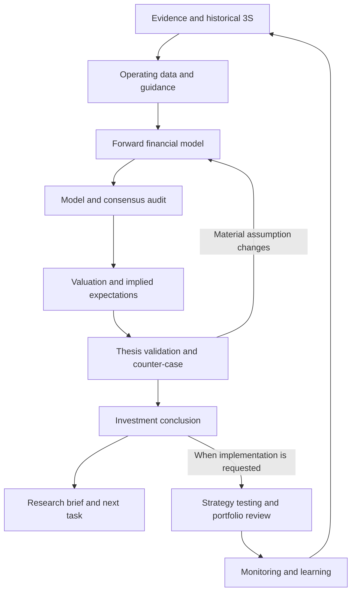

# Pip research analyst skills

Start with [pip-research-cycle](pip-research-cycle/SKILL.md). The primary company workflow builds and audits the model before valuation, validates the resulting thesis, then forms the investment conclusion and brief. Trading/portfolio implementation is a downstream extension. For a narrow request, use the relevant specialist directly.

This is the cleaned project bundle derived from the ten imported skills under `Claude Skills/`. The originals, workbook templates and company examples are retained unchanged. Their live copies under the user's `.claude/skills` directory are not replaced. The bundle is **not automatically loaded into Pip's agent runtime**; [integration notes](pip-research-cycle/references/runtime-integration.md) describe that remaining work.

## Primary analyst sequence

**Evidence -> historical 3S -> operating data -> management guidance -> forward model -> model audit -> valuation/expectations -> thesis validation/challenge -> investment conclusion -> research brief.**

The [detailed sequence](pip-research-cycle/references/company-sequence.md) maps each stage back to the imported skills and explains its input/output gate. Questions arise where an answer can change the model or view; they are not a compulsory final step or a blocker to independent work.



The catalog also includes non-company research and recurring review routes. Those routes do not force corporate financial models onto commodities, FX or crypto. [Workflow details](pip-research-cycle/references/workflow.md) explain selective rework, capability gaps, stopping conditions and the continuing research backlog. [catalog.json](catalog.json) records five routes, including a distinct company-to-portfolio extension.

## What was retained and improved

| Source collection | Cleaned component |
| --- | --- |
| company-model-update | Research-cycle coordinator; autonomous authorised analysis replaces automatic per-step approvals |
| quarterly-3s, volume-data-tab, earnings-call-guidance, revenue-projection-build | Company-model specialist with conditional actuals, driver/guidance, forecast and workbook references |
| penetrate-financial-report-v2 | Financial quality, including an explicit cash-flow and financing review |
| penetrate-narrative-stock-analysis | Conditional valuation/expectations and a provisional thesis, after the model audit |
| investment-thesis-tab; absent conclude-valuation-action dependency | Separate investment-conclusion specialist after thesis validation/challenge |
| management-questions | Decision-sensitive questions, including material accounting/liquidity issues |
| boss-update-note | Audience-aware, concise sourced briefs |
| Missing from the source collection | Evidence intake, cross-asset strategy testing, research challenge, portfolio construction, monitoring and learning |

Full findings and corrections are in [the source audit](../docs/RESEARCH_SKILLS_AUDIT.md). The original company formatting remains an optional [workbook profile](pip-company-model/references/workbook-profile.md), rather than a global product style.

## Handoffs and checks

Each specialist returns a versioned [handoff](pip-research-cycle/references/handoffs.md) with sources, claim classifications, dependencies, checks, material unknowns and next actions. The [JSON schema](pip-research-cycle/references/handoff.schema.json) supports integration; [lib/handoffs.mjs](lib/handoffs.mjs) adds reference and readiness checks. Those checks do not authenticate sources, verify claim truth or authorise any action.

From the repository root after `npm install`:

```powershell
npm run skills:check
npm test
node skills/pip-valuation-thesis/scripts/reverse-dcf.mjs skills/pip-valuation-thesis/references/fcfe-example.json
```

The valuation example is synthetic. The included helper checks a conditional FCFE calculation, explicit units/rates/horizon, root feasibility and forward/reverse numerical consistency. It does not calculate an investment recommendation or inherit the original fixed-year/net-income shortcuts.

No imported workbook writers, COM examples, authentication preflights, dependency installers or report renderers are executed by these checks. To use the prompt skills in Claude/Codex, keep all `pip-*` folders together; instructions load their relevant sibling specialists progressively. The catalog and Node validators are repository development aids. Global installation, live runtime loading and source/tool integration remain explicit separate steps.
